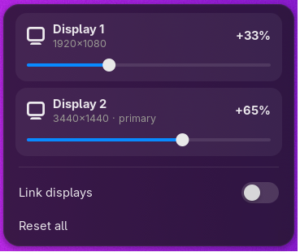

[English](README.md) | **Polski**

# Vibrance (GNOME Shell)

Suwak saturacji ekranu ("digital vibrance") dla GNOME Shell na Waylandzie.
Działa na każdej karcie graficznej (AMD / Intel / NVIDIA), bo to shader nakładany
przez kompozytor, a nie ustawienie sterownika. Saturacja liczona jest w przestrzeni
gamma (luminancja BT.709), tak jak robią to sterowniki GPU w Windowsie.

Inspiracja: [plasma-vibrance](https://github.com/Celiz/plasma-vibrance) (KDE Plasma).

## Wymagania

- GNOME Shell **51** (API shaderów oparte o `Cogl.Snippet`; nie działa na 50 i starszych)
- `glib-compile-schemas` (część `glib2` / `libglib2.0-bin`, zwykle już zainstalowane)

## Instalacja

```sh
git clone https://github.com/wowluka2/vibrance-gnome.git
cd vibrance-gnome
./install.sh
```

Wyloguj się i zaloguj ponownie (wymagane na Waylandzie), potem włącz rozszerzenie:

```sh
gnome-extensions enable vibrance@wowluka2.github.io
```

## Użycie

Kliknij ikonę w górnym panelu i przesuń suwak (0–100%, gdzie 100% = 2× saturacji).
Wartość jest zapamiętywana między sesjami. **Reset** przywraca oryginalne kolory.
Najlepiej wygląda zwykle 20–40%; wyższe wartości przycinają już nasycone kolory.



## Aktualizacja

```sh
git pull && ./install.sh
```

następnie wyloguj się i zaloguj ponownie.

## Odinstalowanie

```sh
./uninstall.sh
```

## Ograniczenia

- Efekt dotyczy całego ekranu (bez ustawień per monitor).
- Pełnoekranowe gry mogą omijać kompozytor, a razem z nim efekt.
- Zrzuty ekranu mogą zawierać zmienione kolory.

## Rozwiązywanie problemów

```sh
gnome-extensions info vibrance@wowluka2.github.io
journalctl -b -o cat | grep -iE "vibrance|JS ERROR"
```

Jeśli stan to `OUT OF DATE`, Twojej wersji GNOME Shell nie ma w `metadata.json`.
Otwórz issue i dołącz wynik `gnome-shell --version`.

## Licencja

[MIT](LICENSE)
